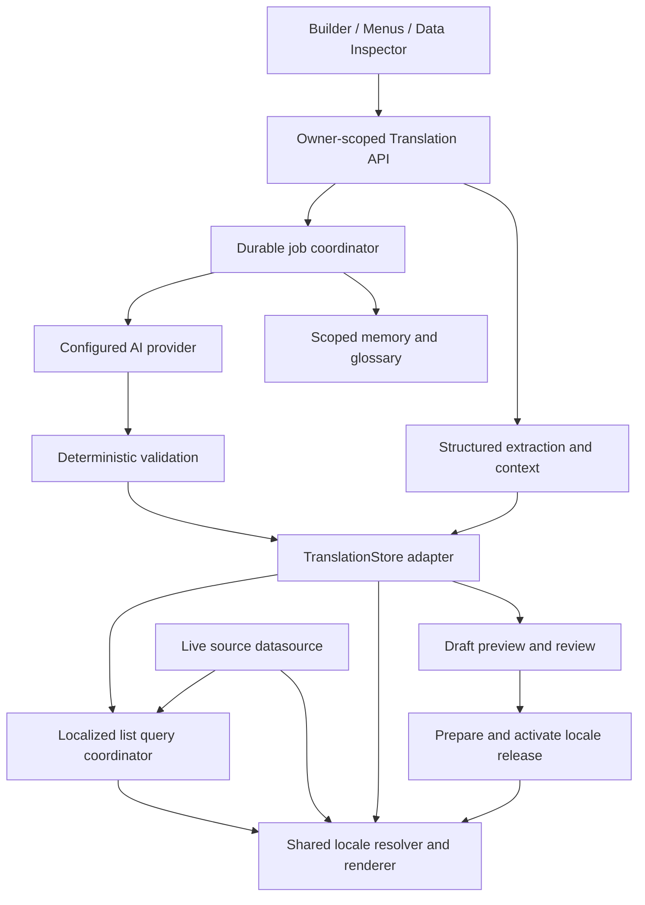

# AI-native translation architecture — 2026-10-16

Status: owner authorizes implementation; M0 core contracts, literal-preserving sitemap comparison and bounded rich-text fixtures are implemented locally. M0 runtime evaluation and remaining contracts are still in progress; bounded revision, immutable input/context and durable SQLite job slices are implemented locally with deterministic providers. No multilingual serving/storage/UI is deployed. The product/storage requirements below come from owner direction; schemas, defaults, runtime choice, APIs and sequencing remain proposed until accepted and verified. [Implementation plan](frontbase-ai-native-translation-implementation-20261016.md). Parked pilot follow-ups remain parked.

## 1. Product contract and boundaries

**Frontbase understands your pages and data, translates them with AI, and lets you refine and publish every language visually.**

Agreed requirements:

- Native Frontbase capability for every template and visually authored app; independently consumable as the standalone edge-native AI translation npm framework package `@frontbase/translation`, not specific to Booking for X or an external translation proxy.
- Enable a language → select pages and data fields → generate contextual translations → preview/refine visually → publish.
- Users may store translations in the same content datasource or choose another Frontbase-supported datasource. A separate datasource is optional.
- Owner deployment: one planned self-hosted Supabase translation store across multiple sites. Provisioning that infrastructure is not part of this planning task.
- Product portability: do not hardcode PostgreSQL schemas, require Supabase, require an external translation-management SaaS, or require another microservice deployment.
- Preserve original content, stable record identities, manual corrections and project boundaries. Background generation, not an AI dependency on every page visit.
- Begin implementation through measured M0 gates; architectural defaults not explicitly agreed remain proposals. Existing catalog expansion, generic reuse, App Users acceptance, lead delivery and production cutover work stays parked.

Proposed defaults: one translation destination per project; shared tables with mandatory tenant/project scope; optional provider namespace/prefix mapping; generated translations remain drafts until approved/published; no forced language redirects. Missing/outdated translation behavior is explicit per content class, with conservative defaults described below. These defaults are proposals, not recorded owner choices.

Non-goals for the first edition: GTranslate migration/cancellation/crawling, WordPress proxying, automatic public deployment, admin-console localization, region-specific pricing/currency conversion, reservations/payments, universal provider parity or multilingual semantic search. Existing publication artifacts are not generic frozen datasource snapshots; no snapshot feature is introduced.

## 2. Architecture and package ownership

Owner-approved extension: add **`@frontbase/translation` as a seventh independently consumable framework library**. This supersedes the earlier six-package-only proposal for localization; existing responsibilities remain in their packages. This is a planned distribution boundary, not npm availability or a full-engine delivery claim. [Extraction/consumability evidence and next work](frontbase-translation-package-20261016.md).

| Package | Ownership |
| --- | --- |
| `translation` | Single-owner schemas, stable unit identities/fingerprints, locale/message/rich-text validation and generic translation lifecycle. Implemented locally: revision/CAS/manual protection and a narrow persistence port with injected SQLite reference adapter. Also implemented locally: immutable selected input/context and durable SQLite jobs through a bounded provider port. Planned: configured AI transport, scoped memory/glossary, releases, full store/budget ports and host scheduling. No imports from its Frontbase consumers, Node-only runtime APIs, UI, credentials or mandatory SDKs. |
| `edge-core` | Native renderer/request-locale integration; compatibility forwards for existing localization imports. It consumes the translation package rather than owning a second engine. |
| `edge-infra` | Frontbase host adapters using existing guarded database/AI transports, queue infrastructure and credential handling. Never a mandatory dependency of the standalone engine. Standalone hosts may implement the same ports or use separately verified optional adapters. |
| `backend` | Frontbase owner/host/source authorization, management endpoints, extraction adapters, budgets/host scheduling integration, localized list coordination and application publication pointers. Delegates reusable lifecycle rules to the engine; not a requirement for standalone consumption. |
| `compiler` | Enumerate translatable component metadata, validate references and generate bounded locale resources with the engine contracts. |
| `builder` | Framework locale-preview/editing hooks; retain the shared renderer. |
| Console app / `ui-components` | Languages/Translations authoring screens, builder controls and Language Switcher integration. |

The standalone engine must be able to extract/accept host-supplied structured resources, translate, validate, review and prepare locale releases through injected capabilities. Frontbase adapters add page/menu/data semantics; another app need not install the CMS to use engine primitives. Root and focused public subpaths expose ESM/TypeScript contracts. A future lightweight `/runtime` and server orchestration/adapters must have separate import graphs; do not export unimplemented entries or include provider SDKs in browser code. AI calls require host-owned server credentials and safe transport. Durable job coordination requires real persisted CAS/leases and a verified runner; an in-memory checkpoint or delivery-only queue cannot claim it.

A separate worker deployment can consume the same package but is optional. Independent npm consumption does not imply an independently hosted service or an on-device model: applications configure an AI provider. The same-or-separate datasource choice remains unchanged. Proposed gzip ceilings are10KiB for a formatter dependency and20KiB incremental public-browser runtime; these are not limits on the npm archive, builder screens, server orchestration or database SDKs and have not yet been adopted as release gates.

## 3. Resource identity and translation units

Two representations share ownership, lifecycle, context and memory:

1. **Messages:** buttons, navigation labels, headings, errors, record-count phrases, placeholders, SEO strings and accessibility labels. Variables/plurals use one selected standard message format.
2. **Structured content:** paragraphs/rich-text nodes, article bodies and selected record fields. Preserve node structure, link destinations and embedded IDs; translate designated text/attributes, not serialized executable HTML or entire records blindly.

`resourceRef` is a versioned, structured tuple, not an ambiguous concatenated string:

- Component: project + page/template/menu ID + stable block ID + authored Block Version ID + property path.
- Record: project + source connection identity + collection/table + typed primary/composite key + field path.
- System message: project + component kind + registered message ID, with per-project override support.

Do not use array position, visible English text, mutable URL or datasource display name as identity. Transient Repeater instance DOM IDs must resolve back to the shared item-template property or underlying record field. Moving a block retains identity; duplicating creates a new identity. Reconnecting the same source requires explicit identity remapping; never guess across databases.

`sourceFingerprint` covers canonical source payload, segmentation/message format version and protected placeholder structure. `contextFingerprint` separately tracks relevant role, neighboring content, glossary/style settings. `memoryKey` covers normalized source/target locales, source content, semantic role, placeholder contract, context/glossary version and reuse scope. Hashes detect changes/deduplication; stable refs preserve history and human corrections. Default and alternative Block Versions are localized as their effective authored properties, with inherited translation references following Default unless overridden.

## 4. Storage configuration and logical model

Settings → Languages → Translation storage:

- Use an existing content datasource, or select another supported connection. A project with several content connections explicitly chooses one destination; do not infer an ambiguous global content datasource.
- Optional schema/table namespace where supported. Recommended logical layout: shared tables scoped by tenant/project; for the owner, one optional `frontbase_translations` schema in the self-hosted destination. Schema-per-project remains an adapter mapping, not a core assumption.
- Validate capabilities/permissions and show a provisioning preview. Create new owned resources through versioned, additive migrations; never alter canonical source tables implicitly. Support binding pre-provisioned resources when DDL access is unavailable.
- Health, capacity, retention, backup/export and storage-move controls. Moving a live store is a separate verified operation, not merely replacing a connection ID.

Small control-plane configuration remains in Frontbase's app state: destination reference, enabled locales/policies, active release pointers and recovery/dispatch references. Bulk units, translation revisions, memory, context payloads, indexes and job-item detail live in the chosen translation destination. Avoid filling the original nearly-full Supabase or the app database with duplicated translation bodies. No credentials in translation payloads or public manifests.

Proposed logical collections (physical layout adapts by provider):

| Collection | Main fields / purpose |
| --- | --- |
| `translation_units` | tenant/project, unit ID, resource ref, source locale, bounded source payload, source/context fingerprints, format/segmenter versions, classification, lifecycle/tombstone |
| `translation_revisions` | tenant/project, unit/target locale, immutable revision ID, translated payload, source fingerprint, provenance (AI/manual/import), creator, expected prior revision, validation report, created time |
| `translation_heads` | unit/locale draft and approved revision refs, monotonic version for compare-and-swap; reviewed actor/time distinct from machine generation |
| `translation_releases` | tenant/project/locale, preparing/ready/active state, sequence, manifest digest, layout/message refs, record revision commit ledger, source/config identity, predecessor |
| `translation_jobs` / `translation_job_items` | idempotency key, durable state, source fingerprint, lease/fencing token, attempts, budget reservations, provider/model/prompt versions, opaque errors and result revision |
| `translation_memory` | explicitly scoped reusable candidates, contextual keys, approved/generated distinction and provenance; not blanket reuse of identical text |
| `translation_glossaries` | project/private or explicitly shared pool, protected names, preferred terms, locale, version and optional style guidance |
| `localized_routes` | stable page/entity identity, locale, normalized public path, aliases, release/state; unique inbound path within owner/project/host-locale mapping |
| `localized_record_index` | derived live query index of permitted localized fields and stable source keys; source/config/revision watermarks; never authoritative source membership or authorization |

Required uniqueness includes owner/project/resource/locale/revision and owner/project/locale/public path. Source record keys are typed and normalized; SQL tables use suitable indexes rather than silently truncating keys. Dates, IDs and money amounts remain typed source data; formatting is separate from translation.

Human edits are new immutable revisions and advance draft heads by CAS. Model jobs cannot overwrite a human head. A source edit preserves prior work, marks it outdated and makes a new candidate; correcting an existing translation does not imply that it remains semantically current forever.

### Adapter capabilities and provider support

Core TranslationStore methods: `probe`, `ensureSchema`, `getUnits`, `readRevisions`, `compareAndSetHead`, `claimJob`, `commitJobResult`, `prepareRelease`, `activateRelease`, `resolvePublishedBatch`, `queryLocalized`, `export`, `health`. Exact signatures and bounded schemas are M0 outputs. Every operation carries trusted owner/project context.

Capabilities: read/write, unique identity, atomic CAS, durable claim/lease, bulk reads, ordered paging, transactional or recoverable release preparation, text search/order, namespace support and schema version. Existing connection support alone does not prove translation-storage support. Deliver an adapter for every relevant writable datasource family; read-only connections cannot host storage. Where a provider cannot enforce concurrency, use a verified Frontbase coordination path or mark that specific capability unavailable; never emulate atomicity with an unsafe read-then-write.

Initial conformance targets: PostgreSQL/Supabase and SQLite-family runners (SQLite/D1/Turso as individually verified). Enumerate other existing connectors in M0; track each as writable implementation, coordinated adapter, read-only or not yet verified. The product goal remains supported-datasource flexibility, with accurate capability reporting rather than an unsupported universal claim. Provider API-only access and SQL execution are distinct paths needing separate proofs.

Supabase implementation: server-only credentials; prefer non-exposed translation schema, least-privilege grants and RLS where exposed, with defensive owner/project enforcement on every backend operation. Shared schemas do not provide tenant isolation by themselves; service-role access does not make app predicates optional. Custom schema API exposure is explicit, not automatic. No anonymous generic table access or source policy weakening.

## 5. Extraction, AI context and generation

Use structured component metadata and bound-field schemas. Inventory display text, rich text, SEO, alt/aria text, menus, form messages, dynamic state messages and supported structured-data display fields. Never translate identifiers, workflows, SQL, URLs, conditions or arbitrary JSON keys. Rich-text content is parsed into a validated tree; protect bindings/links/markup tokens and reject unsupported shape changes. Changing an image/link per locale is an explicit authored override, not an AI side effect.

A generation plan reports selected resources/locales, missing/outdated counts, cache/memory candidates, estimated usage and limits. Structured context includes page title/role, nearby approved text, component purpose, field description, brand/glossary and length guidance. Screenshots are optional later context with explicit data handling; structured context is the initial source of truth. Only selected authorized fields/context leave the host; exclude credentials, private contacts and unselected data. Provider configuration records allowed data classification, destination/model and budget policy. Local-compatible providers can be configured; no hosted Frontbase translation control plane is required.

AI output is untrusted data: bounded structured schema, exact unit IDs and placeholders, complete plural branches, permitted node structure, protected terms, valid locale, no scripts or instructions. Existing @ references become protected typed placeholders through one mapping, not interpolated template expressions sent for rewriting. Deterministic checks are publication blockers; model-based quality scoring is advisory, not proof. Brand terminology and prose context affect reuse; all cross-project memory access requires explicit pool membership and authorized provenance.

Durable flow: planned → queued → leased/running → validated → draft_saved → ready_for_review; failures retry with bounded backoff or become failed/cancelled. Review/approval is separate from job success. Persist before dispatch; delivery carries job IDs, not authority. Claim with lease/fencing, check source and prior head before committing, and reconcile late responses. Never promise exactly-once external billing: retain attempt/accounting receipts and flag uncertain provider outcomes rather than blindly re-requesting.

Idempotency includes project/unit/locale/source fingerprint and policy versions; provider/model changes create explicit regeneration intents rather than rewriting history. Budget reservation, concurrency limits, cancel, resume and progress are first-class. Source changes detected via authored events; external data uses supported hooks/polling/manual refresh with visible watermark. Anonymous visits never initiate unbounded billable generation.

## 6. Authoring and visual UX

**Settings → Languages:** source/enabled locales, native display names, direction, URL mapping, fallback/indexing policies, translation destination and AI provider references. Config is Frontbase core, not Template Settings. Separate credential management remains existing secure settings.

**Languages / Translations workspace:** coverage by page/collection/locale, Missing/Generated/Reviewed/Outdated/Error states, glossary/style guidance, job estimates/progress/cancel, usage/retention and review queue. Proposed access is a Settings entry and builder deep links initially; decide whether volume warrants a top-level sidebar item after the prototype. Do not silently rename/reorganize existing navigation.

**Builder:** source/target locale picker; same renderer and selected layout; source/translation side by side on selection; Generate/Regenerate, edit, history and reset to current approved value. Inherited structure/styles remain shared. Translation edits modify localized payloads only. Structural differences use existing Block Versions with read-only `locale.code` / `locale.direction` @ scope and shared conditions; language is not implemented by cloning every block/page. Preview explicitly identifies draft translations and active design draft; public output reads only approved published revisions.

**Data inspector:** mark fields translatable; pick source language; configure text/rich-text classification and safe context fields; show field-level translations, approval and outdated status. No requirement to add language columns to source tables. Tables/Repeaters/Grids consume one shared localized-query contract.

**Language Switcher:** native element and menu item; dropdown/inline, native language names, current language, optional icons/flags (language is not a country). Real crawlable links resolve equivalent entity/page; retain supported query parameters such as type/sort/search and valid anchors; reset page number when language changes query semantics. Unknown/unpublished locales are not advertised. Preference is persisted; explicit URL wins over preferences. Browser language may suggest a choice, not force redirects.

Suggested missing translation default: published previous translation remains available with an outdated marker in admin, provided source authorization and permitted field still match. For never-translated fields, preview may show clearly marked source fallback. Public fallback/hide/unavailable policy is explicit; do not emit an indexable localized page with mostly untranslated content by accident. Default SEO readiness requires required page/SEO/menu coverage; data readiness and allowed fallback are measured separately. Owner policy choice remains open.

## 7. Publication, runtime and consistency

Locale resolution is server-owned and request-scoped: registered project/domain/path → configured locale → stable resource. Never authorize via language headers, cookies or client-selected project IDs. Provide `locale` context to native renderer, browser/query runtime and builder identically. Avoid a mutable global current-language singleton across concurrent tenants.

Messages/layout localization is prepared as bounded data-only locale catalogs tied to the reviewed layout and immutable translation revisions. No AI or build-tool code evaluation during public requests. Live data remains live; record translation release commits publish approved revisions, not frozen source rows. A translation release sequence identifies approved revision commits; resolving a record chooses a released revision for its stable ref/source policy. Merely approving a draft does not make it public. Newly added live records follow the configured missing-translation policy until translated and released.

Cross-database publication is a prepare/activate protocol, not a claimed distributed transaction: write and verify immutable external release resources/commit ledger; mark ready; CAS the active small pointer in app state. Failure before activation leaves old release active; retry/recovery detects orphaned preparations. Preview and rollback reference exact layout/locale release IDs. Activation rejects source/config/permission changes and competing heads. Current monolingual pages remain unchanged until explicitly enabled/published. No automatic activation or translation of owner pending drafts.

Resolve source rows through existing authorized saved-view query, then batch permitted translations by record refs; never N+1 per-card reads. Language changes do not bypass source filters, projection or App Users policy. Cache keys include tenant/project, locale, layout version, translation release, query, source freshness and appropriate audience identity. Private responses are not shared public cache entries. Recheck row/field authorization before using cached translations; do not leak deleted/restricted source records through old translations.

Translation store outage: default-language path does not consult it. A valid bounded last-known published public catalog may serve under explicit policy; otherwise fail localized output clearly or provide configured source fallback, without publishing partial results. Incomplete localized data/query failures never become empty-success counts. Record readiness/last-sync status is visible. Translation backend failure must not be represented as no records or silently remove locale SEO entries.

## 8. Localized filtering, search, ordering and pagination

Content selection and permissions remain source-owned. Membership-affecting business filters are not translated strings. Distinguish source-field filtering, localized display-field filtering and source fallback behavior in the binding schema. A query carries locale + published release context and registered field operations, not raw SQL.

Modes:

1. **Same database, verified join capability:** join source authorized selection to published localized fields before search/order/count/limit; preserve owner predicates and source field projection.
2. **Separate databases:** maintain a versioned derived localized record index in the translation store, containing stable source IDs, released translated search/order fields and only necessary explicitly approved source query fields. Queue source/release changes into it; preserve watermarks and tombstones. This is a live derived query index, not a canonical dataset or a frozen datasource snapshot.
3. **Fallback source query:** source-language search/order and localized display, clearly labelled. This is a limited mode, not acceptance of full translated search.

The cross-store coordinator must intersect query candidates with the current authorized source saved-view result before counting/paging. It must account for source-only filters/joins, deletions and per-user access. If candidate validation needs a bounded exhaustive pass, it must finish before claiming exact totals; never fetch the first12 translations and filter afterward. For a small verified public catalog, batched membership validation can support exact totals. Large/dynamic/private scopes require a provider-specific exact-query plan or materialized authorized membership with a documented freshness contract and current authorization revalidation. Approximate, stale or capped results cannot masquerade as exact.

Index readiness is explicit by query capability: current, syncing, failed or unsupported. If membership/source freshness cannot be proven, block exact localized search/count mode or use the explicit source-query fallback. Define deletion revocation guarantees separately from eventual text updates. No generic cross-database join/instant-consistency claim. M6 must prove exact behavior for the owner's separate-store scenario before multilingual lists are declared complete.

Locale-aware collation/tokenization differs by adapter. Initial deterministic contract should define supported exact/substring operations and ordering with stable source-key tiebreaker; advanced stemming/semantic search stays separate. Identical locale/query/filter inputs must give consistent server/canvas/browser membership and totals.

## 9. Routes, SEO and RTL

Proposed new-project URL default: default language keeps current path; secondary locales use /ar/...; preserve configurable mappings for subdomains/domains where verified. AI may suggest slugs, but normalized stored mappings determine routes. Resolve both directions by stable page/entity identity, including collision handling, aliases and explicit redirect changes. Reserve locale path prefixes and protect API/admin/assets from accidental locale rewriting. Do not invent a locale page by stripping arbitrary prefixes.

Canonical/hreflang/x-default, sitemap alternates, metadata, Open Graph and translated structured-data display text derive from the same released route registry/readiness. Canonical normally identifies the localized page rather than every translation pointing to English. Query indexing retains existing policy. Only publish hreflang alternatives that actually resolve with eligible content. Validate semantic output and HTTP status, not merely tag presence.

Apply html lang/dir through both document shells, native rendering and preview. Use logical layout properties; verify mixed Arabic/Latin names, numbers, URLs, controls, forms and tables with explicit bidi isolation where needed. Language formatting does not convert currencies or mutate numerical source values. Do not mechanically reverse all icons or images.

## 10. Runtime/library decision gate

No library selected. **None of the shortlisted libraries is an explicitly valid outcome**, confirmed by the owner. Candidate shortlist: i18next with one consistent message format, Unicode MF2/messageformat, and FormatJS ICU. Use a narrow core MessageResolver adapter so UI and storage models do not depend on a vendor. One implementation and one message format for first release; do not stack independent localization engines or assume ICU MF1 and MF2 are interchangeable.

The no-library option is evaluated against the same product requirements and maintenance cost. Native `Intl` supplies plural categories and number/date formatting, but not a message grammar, catalog, interpolation validator, storage, AI generation or visual editing. Our hand-authored Intl fixture is a reference, not a feature-equivalent replacement. Selecting none does not authorize an ad hoc executable message language or dropping plural/validation requirements: document how each required behavior is provided, or keep that decision open. A narrow formatter dependency may still be justified without adopting a full localization framework. AI-native product behavior and same/separate translation storage remain Frontbase responsibilities whichever outcome is chosen.

Compare Arabic zero/one/two/few/many/other, variable reordering, protected rich-text tokens, dynamic database catalogs, request isolation, fallback, RTL/bidi, worker constraints, no executable catalog code, bounded validation, bundle/cold-start cost, license/export and identical server/canvas/browser output. Record exact pinned versions and benchmark results before an accepted decision. Optional XLIFF/JSON exchange is a later adapter; do not promise lossless interchange for unsupported format features.

## 11. Reliability, lifecycle and operational requirements

- Store provisioning/migrations are additive and idempotent; track adapter schema version. Verify insufficient privileges, interruption and restart. No silent source alteration.
- Store relocation: prepare/verify destination, reconcile writes with a journal/maintenance fence, validate counts/digests and published revisions, CAS config, retain old read path for bounded rollback. Never switch live storage without data verification.
- Bulk translation jobs enforce project/owner budgets, concurrency, field selection and cancellation; provider errors/credentials never reach public pages.
- Retention controls distinguish drafts, audit/job details, memory and published references. Never prune revisions needed by active/prepared/retained rollback releases. History growth is measurable and capped by explicit policy.
- Metrics: coverage/outdated/invalid counts, queue age/retries, spend estimates/actual usage, cache hits, source/index watermarks, per-locale uptime/404s and store capacity. No raw private content in default logs.
- Export preserves identities, locales, formats, approved revisions and route mappings; restored data is scoped/remapped explicitly to prevent accidental cross-project exposure.

## 12. Borrowed concepts and evidence

[translation-edge architecture](../../../translation-edge/ARCHITECTURE.md) and decisions DEC-002/003/004 supplied memory, protected corrections, deterministic two-way paths, queued/prewarmed generation and default-language resilience. The original proxy, DOM-tree alignment, globally shared text-hash lookup and fixed-cost claims are not adopted. No standalone proxy implementation was found; source records describe the service as proposed. Migration extraction/cancellation rules remain deferred.

Existing Frontbase seams inspected: `edge-infra/src/providers/types.ts` (optional transactions), `backend/src/compat/providers/types.ts` (credential normalization), queue providers/dispatchers (delivery versus durable state), `edge-core/src/shell.ts` and `ssr/htmlDocument.ts` (different language support), existing live binding/publication/conditions contracts. Existing locale/date support is partial, not native multilingual completion.

Research references (reviewed 2026-10-16): [Unicode MessageFormat](https://messageformat.unicode.org/), [messageformat implementation](https://github.com/messageformat/messageformat), [FormatJS](https://formatjs.github.io/docs/intl-messageformat/), [i18next API](https://www.i18next.com/overview/api), [Tolgee contextual AI pattern](https://docs.tolgee.io/platform/translation_process/ai_translator), [Google multilingual guidance](https://developers.google.com/search/docs/specialty/international/managing-multi-regional-sites). These support evaluation, not a runtime selection or new release claim.

## 13. Owner choices still open

Confirm first language pair; generated-draft versus eligible auto-publish policy; never-translated/outdated public fallback; native names/flags; initial URL scheme for new projects; availability of optional AI providers and budget limits; explicit shared memory pools. Proposed initial acceptance is English/Arabic, reviewed drafts, subdirectory locale URLs, project-private memory and optional explicitly shared glossary. Migration choices remain deferred and do not block core design.

## 14. Sitemap-first URL preservation and optional Search Console

Owner requires comparison for **every site and every locale**, because other WordPress sites use translated slugs. Never generalize USA's prefix-only result to the estate. Preserve the exact published URL literal separately from comparison keys, including encoding, case, query and trailing-slash shape. The source of route truth is a reviewed URL-to-resource ledger, not an AI-generated slug or sitemap array position.

Discovery priority: published source and translated sitemap indexes/child sitemaps → source content inventory and reviewed mappings → optional Search Console performance/inspection observations. Recursively follow declared sitemap indexes, including paginated query URLs and bounded gzip content; do not convert this into an unrestricted link crawl. Store provenance, fetched time, HTTP/final URL, hash and missing/failed states. Harden the future fetcher with existing guarded network transport, verified project host allowlists, redirect/rebinding protections, time/size/decompression/depth/request budgets and XML DTD/external-entity refusal. Missing/unreadable locale maps are unknown/error, never evidence that URL translation is disabled.

Always compare URL sets, not list positions. Exact normalized prefix matches are discovery candidates only; preserve unmatched originals/translations for mapping review. Confirm translated-slug pairs using stable source IDs, reviewed reciprocal hreflang/canonical evidence or explicit manual review; ambiguous/conflicting/duplicate normalized paths block import. Same slugs still need source identity/content verification before route activation. Store locale/source/target literal, resource identity, mapping provenance and review state. Every enabled locale needs an explicit comparison outcome, even if its final table is identity-prefix only.

Read-only USA observation on 2026-10-16: supplied indexes `https://study-in-usa.com/sitemap.xml` and `https://study-in-usa.com/ar/sitemap.xml` each returned200 and declared four children: home, posts, posts?page=2 and custom-posts?type=job_listing. Child entry counts per language were1/500/455/310 (1,266 entries; not a deduplicated whole-site/index count). All1,265 non-home entries matched after removing /ar/; homepage literals were the bare domain and bare /ar. This is historical site-specific evidence, not a permanent setting or proof that every WP URL/indexed page is included. Do not infer entity correspondence solely from the order of child entries. No production content was crawled or migrated by that check.

Optional Search Console connector: owner-scoped read-only OAuth account/property selection, encrypted existing credential storage and property-to-project binding; page-dimension performance imports with date/type/provenance; known-URL inspection with quota-aware durable batching/backoff and observed timestamps. Do not label Search Analytics URLs as a complete index export, equate no impressions with no index presence, or claim that inspection enumerates URLs/exports translated bodies. Keep separate flags for sitemap discovery, search observation, inspection result, source mapping and translation recovery. Google currently documents 2,000 URL inspections per property/day; treat current service quotas as configuration, reverify before implementation. Public translated content recovery is a separate bounded migration/import step, not Google data export. Existing provider data cooperation is not required to inventory publicly served URLs, but private translation history/glossaries/manual provenance may remain unavailable.

Search Console and sitemap harvesting are optional migration/SEO adapters; native translation works without them. Bulk extraction, cancellation or WordPress cutover remain deferred. The deterministic comparison primitive belongs to M0; network/OAuth/import UI belongs to a separately claimed follow-up, without blocking core localization.

References: [Search Analytics API](https://developers.google.com/webmaster-tools/v1/searchanalytics/query), [URL Inspection API](https://developers.google.com/webmaster-tools/v1/urlInspection.index/inspect), [authorization](https://developers.google.com/webmaster-tools/v1/how-tos/authorizing), [quotas](https://developers.google.com/webmaster-tools/limits).
